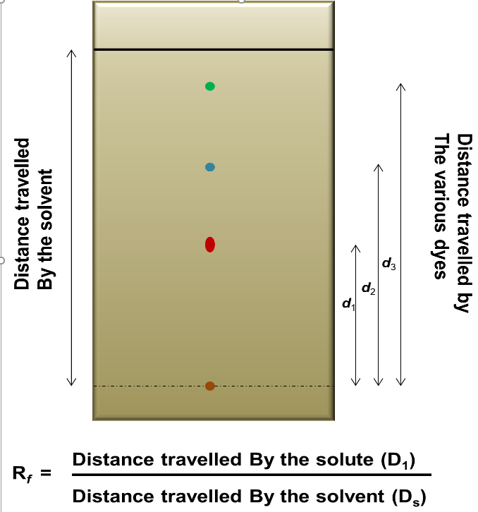

Chromatography is an important analytical and separation technique used in biochemistry, biotechnology, pharmaceutical science, molecular biology and chemical analysis. It is widely used to separate, identify, purify and quantify different components present in a complex mixture. The basic principle of chromatography is based on the differential distribution of components of a mixture between two phases: a stationary phase and a mobile phase. Chromatography works on the principle of the differential affinity, adsorption, partitioning or distribution of different components between a stationary phase and a mobile phase.

When a mixture containing different compounds is introduced into a chromatographic system, its components interact differently with the two phases.

Components having a greater affinity towards the stationary phase move slowly through the chromatographic system.

Components having a greater affinity towards the mobile phase move faster.

Components with intermediate affinities migrate at intermediate rates.

As a result, the individual components become separated from one another.

The separation depends on several physicochemical properties, including:

Molecular size and shape.

Polarity of the compounds.

Solubility in the mobile phase.

Adsorption capacity towards the stationary phase.

Ionic charge and electrostatic interactions.

Hydrogen bonding and hydrophobic interactions.

Chromatography mainly consists of the following components:

A. Stationary Phase: The stationary phase is the phase that remains fixed during the chromatographic separation. It interacts with the components of the mixture and influences their movement. Examples: Silica gel, Alumina, Cellulose, Ion-exchange resins, Porous polymer beads

B. Mobile Phase: The mobile phase is the fluid that moves through or over the stationary phase and carries the components of the mixture. It can be:

Liquid (solvent or solvent mixture).

Gas (carrier gas).

Examples include water, methanol, ethanol, acetonitrile and hexane.

C. Sample or Analyte: The sample is the mixture containing different chemical or biological compounds that need to be separated, identified or quantified.

D. Detector: A detector is used in instrumental chromatography to identify the separated components and measure their abundance. Examples include: UV-visible detector, Fluorescence detector, Refractive index detector, Mass spectrometer.

Types of Chromatography

Chromatography can be classified according to the separation mechanism and the physical nature of the stationary and mobile phases.

1. Paper Chromatography: Separation occurs mainly through partitioning of compounds between water associated with cellulose paper and the mobile solvent.

2. Column Chromatography: Compounds are separated through a column containing a stationary phase while a mobile phase flow through it.

3. Thin-Layer Chromatography: Compounds are separated on a thin layer of adsorbent material supported on a plate.

4. High-Performance Liquid Chromatography (HPLC): Uses a liquid mobile phase under high pressure to separate and quantify compounds with high resolution.

5. Gas Chromatography (GC): Uses a gaseous mobile phase to separate volatile and thermally stable compounds.

6. Ion-Exchange Chromatography: Separates molecules based on differences in their electrical charges.

7. Size-Exclusion Chromatography: Separates molecules according to their size and hydrodynamic volume using porous beads.

8. Affinity Chromatography: Separates molecules based on specific biological interactions, such as antigen-antibody or enzyme-substrate binding.

### Thin-layer chromatography

The thin layer chromatography technique is an analytical chromatography to separate and analyze free amino acids from proteins. In this method, the silica or alumina as a stationary phase is coated on to a glass or aluminum foil as thin layer and then a sample is allowed to run in the presence of a mobile phase (solvent). In comparison to other chromatography techniques, the mobile phase runs from bottom to top by diffusion (in most of the chromatography techniques, mobile phase runs from top to bottom by gravity or pump). As sample runs along with the mobile phase, it gets distributed into the solvent phase and stationary phase (Figure 1). The interaction of sample with the stationary phase retard the movement of the molecule whereas mobile phase implies an effective force onto the sample.

Suppose the force caused by mobile phase is **Fm** and the retardation force by stationary phase is **Fs**, then effective force on the molecule will be **(Fm - Fs)** through which it will move. The molecule immobilizes on the silica gel (where, Fm = Fs) and the position will be controlled by multiple factors.

1. Nature or functional group present on the molecule or analyte.
2. Nature or composition of the mobile phase.
3. Thickness of the stationary phase.
4. Functional group present on stationary phase.

<b>Rf = $\frac{Distance\ Travelled\ by\ Analyte\ Front\ (d_1)}{Distance\ Travelled\ by\ Solvent\ Front\ (d_s)}$</b>

<b>Figure 1: TLC plate with the separation of amino acids and Rf values</b>

